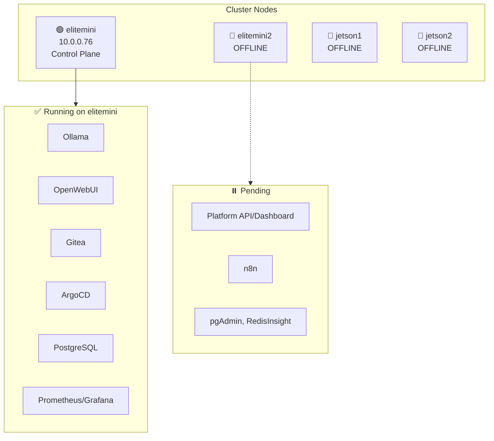
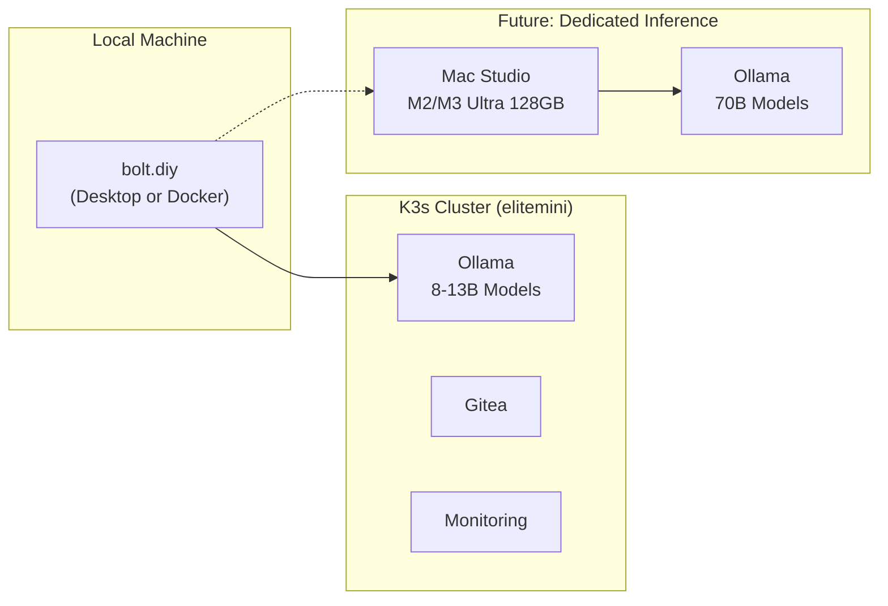

# Infrastructure Evaluation & Strategic Plan

**Date:** December 23, 2025  
**Status:** Planning  
**Last Active Development:** August 2025

## Executive Summary

After 4-6 months of inactivity, this document evaluates the current state of the Local AI Infrastructure project and establishes a strategic direction forward. The core finding: **continue using existing infrastructure for its strengths, but pivot from custom v0 clone development to deploying bolt.diy**.

---

## Current State Assessment

### Cluster Health

| Node          | IP              | Role          | Status     |
| ------------- | --------------- | ------------- | ---------- |
| **elitemini** | 10.0.0.76   | Control Plane | 🟢 Ready   |
| elitemini2    | 192.168.131.209 | Worker        | 🔴 Offline |
| jetson1       | 192.168.131.123 | GPU Worker    | 🔴 Offline |
| jetson2       | 192.168.131.163 | GPU Worker    | 🔴 Offline |

**Impact:** Many pods are Pending due to node affinity to offline nodes.

### Running Services (Healthy on elitemini)

| Category           | Services                                       |
| ------------------ | ---------------------------------------------- |
| **AI/ML**          | Ollama (x2), OpenWebUI, Qdrant                 |
| **GitOps**         | ArgoCD, ArgoCD Image Updater, Gitea            |
| **Databases**      | PostgreSQL, Redis                              |
| **Serverless**     | Fission (Python, NodeJS, TypeScript pools)     |
| **Monitoring**     | Prometheus, Grafana, Alertmanager              |
| **Infrastructure** | Traefik, MetalLB, Cert-Manager, Sealed Secrets |
| **Other**          | Supabase, Dapr, Homepage Dashboard             |

### Pending/Broken Services

- Platform API (custom v0 clone) - Pending
- Platform Dashboard - Pending
- n8n Automation - Pending
- MCPO Control Panel, Codegen Service, pgAdmin, RedisInsight

### v0 Clone Pipeline Status

| Layer   | Component                                    | Status          |
| ------- | -------------------------------------------- | --------------- |
| Layer 1 | AI Generation (Planner + Implementer Agents) | ✅ Complete     |
| Layer 2 | Git Repository (Gitea)                       | ✅ Complete     |
| Layer 3 | Container Build (BuildKit)                   | ⚠️ Partial      |
| Layer 4 | Kubernetes Deployment                        | ❌ Not Complete |
| Layer 5 | Ingress/Domain Allocation                    | ❌ Not Complete |

---

## Strategic Decision

### The Problem

Building a custom v0 clone requires significant ongoing effort to compete with:

- **bolt.diy** (18.7k stars, 1600+ contributors, MIT licensed)
- **OpenHands** (formerly OpenDevin)
- Commercial offerings (v0, bolt.new, Lovable, Replit Agent)

The custom platform code solves a problem already solved better elsewhere.

### The Solution

**Pivot to bolt.diy** for local v0 functionality:

- Native Ollama integration with model management UI
- Docker and Kubernetes deployment options
- Electron desktop app available
- Active community maintaining system prompts for different models
- Supports 19+ AI providers including local (Ollama, LM Studio)

---

## Hardware Strategy for Local Inference

### Current Problem

- Jetsons (8GB each) cannot pool memory for LLMs
- Mac Mini M4 16GB via Exo: OS overhead reduces usable RAM to ~8GB each
- Distributed inference adds latency, kills interactivity
- **Conclusion:** Need contiguous memory in a single machine

### Recommendations

| Budget      | Hardware                     | Capability                    |
| ----------- | ---------------------------- | ----------------------------- |
| **~$2K**    | RTX 4090 (24GB)              | 32B models (Qwen 2.5 Coder)   |
| **~$5-6K**  | Mac Studio M2/M3 Ultra 128GB | 70B models, silent, efficient |
| **~$8-10K** | Mac Studio M4 Ultra 192GB    | 70B Q8, future-proof          |

**Recommended:** Mac Studio M2/M3 Ultra 128GB (refurbished)

- Runs 70B Q4 at 10-15 tok/s (usable for coding)
- Silent operation
- Native Ollama/mlx support
- Can run bolt.diy Electron app directly

---

## Action Plan

### Phase 1: Cleanup (Immediate)

#### Remove Stale Git Artifacts

```bash
# Remove merged worktrees
rm -rf worktree-argocd worktree-ts-fix

# Prune stale branches
git branch -d feature/argocd-cicd fix/typescript-errors
git remote prune origin
```

#### Clean Stuck Kubernetes Resources

```bash
# Force delete terminating namespaces
kubectl delete namespace knative-serving openfunction --force --grace-period=0

# Delete test project namespaces
kubectl delete namespace project-buildkit-test project-buildkit-test2 \
  project-e2e-final-test project-e2e-simple-test project-e2e-test-project \
  project-hello-world-test project-nextjs-blog-test project-test-duplicate-repo \
  project-test-duplicate-repo-2 project-test-unique-repo project-todo-app-test \
  project-ui-test-project
```

### Phase 2: Deploy bolt.diy

#### Option A: Desktop App (Simplest)

Download from: https://github.com/stackblitz-labs/bolt.diy/releases

#### Option B: Docker on K3s

```bash
# Clone bolt.diy
git clone -b stable https://github.com/stackblitz-labs/bolt.diy.git

# Configure to use existing Ollama
# Set OLLAMA_BASE_URL=http://ollama.ai-services.svc.cluster.local:11434

# Deploy via Docker Compose or create K8s manifests
```

### Phase 3: Infrastructure Decisions

#### Keep Running

- [x] Ollama + OpenWebUI (local chat interface)
- [x] Gitea (self-hosted Git, useful for any project)
- [x] ArgoCD (GitOps knowledge, reusable)
- [x] PostgreSQL, Redis, Qdrant (databases)
- [x] Monitoring stack (always useful)
- [x] Fission (serverless for custom functions)

#### Archive/Remove

- [ ] `platform-api/` - Archive, reference only
- [ ] `platform-dashboard/` - Archive, reference only
- [ ] `services/codegen-service/` - Superseded
- [ ] Legacy `k8s/` directory - Keep `k8s-kustomized/` only
- [ ] Test project namespaces - Delete

#### Hardware Decisions

- [ ] **elitemini2:** Remove from cluster or repurpose
- [ ] **Jetsons:** Repurpose for edge inference (vision/voice) or decommission
- [ ] **New hardware:** Evaluate Mac Studio purchase for 70B local inference

---

## What Was Learned

This project provided deep hands-on experience with:

1. **Kubernetes/K3s** - Cluster management, troubleshooting, GitOps
2. **AI Infrastructure** - Ollama, model serving, inference optimization
3. **Multi-Agent Systems** - Planner/Implementer agent architecture
4. **CI/CD Pipelines** - ArgoCD, BuildKit, container registries
5. **Distributed Systems** - Why memory pooling for LLMs doesn't work well

This knowledge transfers to any future infrastructure work.

---

## Files Reference

| Directory             | Status     | Notes                             |
| --------------------- | ---------- | --------------------------------- |
| `k8s-kustomized/`     | ✅ Keep    | Source of truth for GitOps        |
| `platform-api/`       | 📦 Archive | Custom v0 clone backend           |
| `platform-dashboard/` | 📦 Archive | Custom v0 clone frontend          |
| `docs/`               | 🔄 Review  | Some outdated documentation       |
| `scripts/`            | 🔄 Review  | Some still useful                 |
| `ansible/`            | 📦 Archive | Initial provisioning, rarely used |
| `functions/`          | ✅ Keep    | Fission serverless functions      |
| `archive/`            | 🗑️ Delete  | Docker Swarm leftovers            |

---

## Architecture Diagrams

### Current Cluster State



### Target State with bolt.diy



---

## Next Steps

1. [ ] Review and approve this plan
2. [ ] Execute Phase 1 cleanup
3. [ ] Deploy bolt.diy (desktop or K8s)
4. [ ] Evaluate hardware purchase timeline
5. [ ] Update CLAUDE.md to reflect new direction

---

## Appendix: bolt.diy Quick Reference

**Repository:** https://github.com/stackblitz-labs/bolt.diy
**Releases:** https://github.com/stackblitz-labs/bolt.diy/releases
**License:** MIT (code), WebContainers API requires license for commercial use

### Key Features

- 19+ AI provider integrations including Ollama
- Docker and Electron desktop app support
- Built-in model management for Ollama
- File locking, diff view, Git integration
- Deploy to Netlify, Vercel, GitHub Pages

### Running with Ollama

```bash
# Set in .env.local
OLLAMA_BASE_URL=http://localhost:11434

# Or point to cluster Ollama
OLLAMA_BASE_URL=http://10.0.0.76:31434
```
